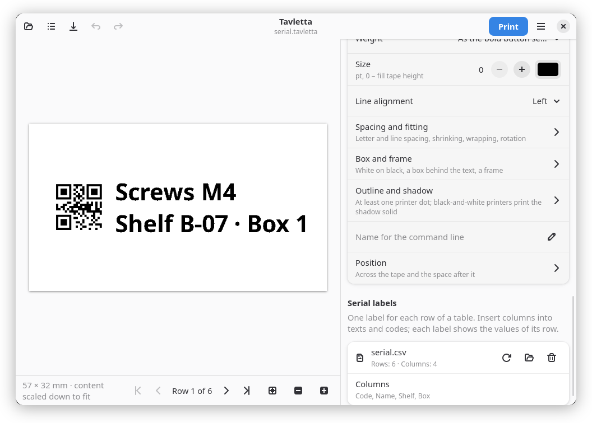

# Tavletta

Label designer for the Linux desktop: design labels with text, images,
symbols and codes, see them exactly as they will be printed, and print them
on label printers, office printers or through its own print server.

Tavletta is Romansh for a small tablet (from tavla, table/board). Pronounced tav-LET-ta.

<picture><source media="(prefers-color-scheme: dark)" srcset="docs/screenshots/main-dark.png"></picture>

<picture><source media="(prefers-color-scheme: dark)" srcset="docs/screenshots/serial-dark.png"></picture> <picture><source media="(prefers-color-scheme: dark)" srcset="docs/screenshots/colour-dark.png"></picture>

More in [docs/screenshots.md](docs/screenshots.md).

## Features

- Endless tape, die-cut labels and over 1700 label sheets for office printers
- Text in any font, images, lines and shapes, over 7000 symbols
- QR code, Data Matrix, PDF417, Aztec, Code 128, EAN, UPC, GS1 and more, sharp at every printer's resolution
- Serial labels from CSV, ODS or XLSX files; variables such as dates and counters
- Shipping labels from a carrier's PDF or image
- Finds printers on the network and explains printer problems in plain words
- `tavletta print` on the command line, `tavletta serve` as a print server with a REST API and MCP
- GTK 4 and libadwaita, in 27 languages

All of it: [docs/features.md](docs/features.md). How labels are laid out: [docs/layout.md](docs/layout.md).

## Supported printers

- Brother VC-500W (colour), Brother QL, Brother P-touch
- cab EOS2, EOS5, SQUIX 4, MACH 4S
- NIIMBOT B1, B21, B3S, B4, D11, D110, D101
- Zebra (ZPL, EPL2), TSPL printers, DYMO LabelWriter, ESC/POS receipt printers
- Any system printer through CUPS or IPP, also on label sheets

Over the network or USB; several of them are not yet tried on a printer.
Details and protocols: [docs/printers.md](docs/printers.md).

## Install

- **Flatpak**: the bundle from the [latest release](https://git.joshuahirsig.xyz/joshii/tavletta/releases/latest); Flathub is in preparation
- **Print server**: `docker pull ghcr.io/joshii-h/tavletta:1.1` ([server installation](https://tavletta.joshuahirsig.xyz/server-install/))
- **pip**: `pip install "git+https://git.joshuahirsig.xyz/joshii/tavletta.git@v1.1.0"`, or `./install.sh` from a clone

System packages, building the Flatpak and the first start: [docs/install.md](docs/install.md).

## Documentation

- User guide (English, German): <https://tavletta.joshuahirsig.xyz>
- [Variables and command line](docs/cli.md)
- [Print server and MCP](docs/server.md), [REST API (OpenAPI)](docs/openapi.yaml)
- All documents: [docs/README.md](docs/README.md)

## Contributing

Contributions are welcome, see [CONTRIBUTING.md](CONTRIBUTING.md). Issues and
pull requests on [GitHub](https://github.com/joshii-h/tavletta) are welcome,
no Forgejo account needed: they are carried over automatically to the
[Forgejo repository](https://git.joshuahirsig.xyz/joshii/tavletta), where
review and merge happen. Please follow the [code of conduct](CODE_OF_CONDUCT.md);
report vulnerabilities as described in [SECURITY.md](SECURITY.md) and
barriers as in [ACCESSIBILITY.md](ACCESSIBILITY.md).

## Credits

Tavletta builds on the work of many projects: labelprinter, Zint, segno,
Pillow, Poppler, gLabels, Material Design Icons, LPrint and others. Who did
what: [CREDITS.md](CREDITS.md).

## License

AGPL-3.0-or-later, like labelprinter which it builds on; the label sheet
templates (`tavletta/sheets/templates.json`) and the parts derived from
ThermalPrint are MIT licensed, the symbols (`tavletta/symbols/mdi.json.gz`)
Apache-2.0 licensed. The Python package as a whole:
`AGPL-3.0-or-later AND MIT AND Apache-2.0` (`pyproject.toml`); the app as
the Flatpak ships it, with the libraries it bundles (Zint, segno, Pillow,
Poppler): `AGPL-3.0-or-later AND MIT AND Apache-2.0 AND BSD-3-Clause AND MIT-CMU AND (GPL-2.0-only OR GPL-3.0-only)` (the metainfo). Details and licence texts:
[THIRD_PARTY_NOTICES.md](THIRD_PARTY_NOTICES.md). Not
affiliated with Brother Industries, cab Produkttechnik GmbH & Co. KG or the
makers of the other printers; "Brother", "ColAura", "VC-500W", "P-touch",
"TZe", "HSe", "cab", "EOS", "SQUIX", "MACH", "Zebra", "ZPL", "EPL", "TSC",
"TSPL", "Munbyn", "iDPRT", "Xprinter", "Rollo", "Epson", "ESC/POS", "DYMO",
"LabelWriter" and "NIIMBOT" are trademarks of their owners; ZINK is a
trademark of ZINK Holdings LLC.
