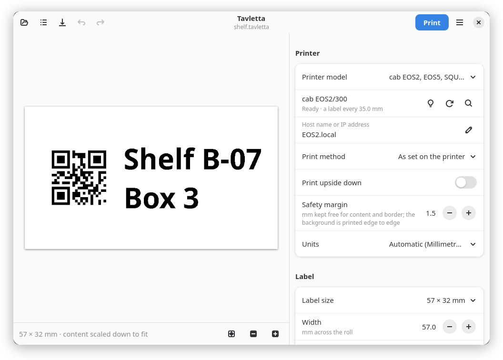

# Etiketto

Label designer for the Linux desktop. Design labels with text, images and
codes, see them exactly as they will be printed, and print them over the
network on endless tape or on die-cut labels. Etiketto talks to each
printer in its own language, finds it on the network and explains printer
problems in plain words.

GTK 4 and libadwaita, in 27 languages: English, German, French, Italian,
Spanish, Portuguese (Portugal and Brazil), Dutch, Swedish, Finnish,
Estonian, Polish, Hungarian, Russian, Ukrainian, Turkish, Arabic, Hindi,
Thai, Vietnamese, Indonesian, Malay, Korean, Japanese and Chinese
(Traditional for Taiwan and Hong Kong, Simplified).

User documentation (English, German): <https://etiketto.joshuahirsig.xyz>

## Supported printers

| Printer | Labels | What Etiketto does with it | Protocol |
|---|---|---|---|
| Brother VC-500W (ColAura) | Colour on ZINK tape cassettes, 9 to 50 mm wide, any length | Detects the cassette, remaining tape and the cassette's age; vivid, normal or black-and-white colours; full, half or no cut; colour adjustment | Brother's native protocol on TCP port 9100 or USB ([docs/vc500w.md](docs/vc500w.md)) |
| Brother P-touch (PT-P700, PT-P750W, PT-E550W, PT-P710BT, PT-P900 series, PT-D series, older PT models), untested on hardware | Black on TZe tape 3.5 to 36 mm wide and HSe heat-shrink tube, any length | Detects the tape, its type and printable width; full, half or no cut, chain printing, high resolution, tape feed; explains Editor Lite mode | Brother's raster commands on USB or TCP port 9100 ([docs/ptouch.md](docs/ptouch.md)) |
| cab EOS2, EOS5, SQUIX 4, MACH 4S | Black on die-cut labels up to 105.6 mm wide, 203, 300 or 600 dpi, thermal direct or transfer | Reads the resolution and the measured label distance and warns if the roll does not match; cancels a job stopped by a problem | JScript on TCP port 9100 or USB ([docs/cab.md](docs/cab.md)) |
| System printer (CUPS, IPP) | Paper or labels in any size the printer takes: office printers, printers set up in CUPS (USB too), IPP Everywhere printers on the network | Lists the CUPS queues and the IPP printers on the network; prints the label as one page at exactly its size; explains paper, toner and cover problems | IPP to CUPS on this computer or straight to the printer ([docs/system.md](docs/system.md)) |

Connections: network (LAN or Wi-Fi) for all of them (P-touch: the models
with network); USB too, through the kernel's printer driver: cab printers,
P-touch printers and the VC-500W are found on USB by themselves, and the
system printer reaches every printer CUPS has, USB included. On USB, the
VC-500W and cab printers have not been tried on a printer yet; P-touch
printers have not been tried at all. Your user needs to be in the group `lp`
(`sudo usermod -aG lp $USER`, then log in again). The Flatpak has
`--device=all` for this: `/dev/usb/lp*` is not covered by `--device=usb`.

Each printer family is a backend; adding one does not touch the rest of
the app, see [CONTRIBUTING.md](CONTRIBUTING.md#adding-a-printer).
Developed with a VC-500W, an EOS2/300 and, for the system printer,
CUPS's simulated IPP Everywhere printer and an HP LaserJet Pro 4002. Not supported yet: continuous
media and the cutter of cab printers.

## Screenshots

<picture><source media="(prefers-color-scheme: dark)" srcset="docs/screenshots/main-dark.png"></picture>

| | |
|---|---|
| <picture><source media="(prefers-color-scheme: dark)" srcset="docs/screenshots/colour-dark.png"></picture> | <picture><source media="(prefers-color-scheme: dark)" srcset="docs/screenshots/sticker-dark.png"></picture> |
| Full colour: background image printed edge to edge | Sticker: fixed 50 × 50 mm, image and border |
| <picture><source media="(prefers-color-scheme: dark)" srcset="docs/screenshots/expand-dark.png"></picture> | <picture><source media="(prefers-color-scheme: dark)" srcset="docs/screenshots/print-dark.png"></picture> |
| Text with any font, colour and size | Copies, cut mode, vivid or normal colours |
| <picture><source media="(prefers-color-scheme: dark)" srcset="docs/screenshots/cable-de-dark.png"></picture> | <picture><source media="(prefers-color-scheme: dark)" srcset="docs/screenshots/die-cut-dark.png"></picture> |
| German interface (27 languages in total), 12 mm cable label | Die-cut label on a cab EOS2: QR code and text on 57 × 32 mm |

Screenshots use the default GNOME style; Etiketto follows your desktop's light or dark mode and accent colour.

The labels shown are in [`docs/examples`](docs/examples); open them with Etiketto.

## Features

- Finds the printer on the network by itself and shows its state
- Endless tape: as long as the content, or a fixed length
- Die-cut labels: common or custom sizes, content across or along the roll
- Text with any installed font, bold/italic, colour, multiple lines, size
  fitted to the label or fixed in pt; emoji and font fallback via Pango
- Images and photos, background colour, background image, border
- QR codes, Code 128 and EAN-13 barcodes
- Live preview at print resolution: what you see is what is printed
- Millimetres or inches, chosen from the system language
- Printer problems explained in plain words, with what to do;
  *Report a problem* prepares an issue with all the details
- Save labels as `.etiketto` files (images embedded) and reuse them as templates
- Drag and drop images or `.etiketto` files onto the window
- Export as PNG

What each printer adds is listed under [Supported printers](#supported-printers).

## Install

Requirements from your distribution: Python 3.11+, PyGObject with GTK 4
and libadwaita, pycairo, gettext. Everything else goes into a private
virtual environment.

```sh
git clone https://git.joshuahirsig.xyz/joshii/etiketto.git
cd etiketto
./install.sh                # per user, no root; ./install.sh --uninstall
```

| Distribution | system packages |
|---|---|
| Debian / Ubuntu | `python3-gi gir1.2-gtk-4.0 gir1.2-adw-1 python3-gi-cairo python3-venv gettext` |
| Fedora | `python3-gobject gtk4 libadwaita python3-cairo gettext` |
| Arch | `python-gobject gtk4 libadwaita python-cairo gettext` |
| Gentoo | `dev-python/pygobject gui-libs/gtk:4 gui-libs/libadwaita dev-python/pycairo sys-devel/gettext` |

Then start **Etiketto** from the app menu and choose the **Printer model**.
Etiketto looks for the printer on the network; otherwise enter its host
name, e.g. `VC-500W1234.local` or `EOS2.local` (needs mDNS / nss-mdns), or
its IP address. For the VC-500W, outside Flatpak, the host is also read from
`~/.config/labelprinter/config.json` if you use the `labelprinter` CLI.
In Flatpak, `.local` names are resolved through the system's Avahi daemon.

### Flatpak (build locally)

```sh
flatpak install --user flathub org.gnome.Sdk//51 org.gnome.Platform//51
flatpak-builder --user --install --force-clean build-dir \
    build-aux/flatpak/xyz.joshuahirsig.Etiketto.yml
flatpak run xyz.joshuahirsig.Etiketto
```

Check it like Flathub does:

```sh
flatpak install --user flathub org.flatpak.Builder
flatpak run --command=flatpak-builder-lint org.flatpak.Builder \
    manifest build-aux/flatpak/xyz.joshuahirsig.Etiketto.yml
```

## How labels are laid out

Elements (text, image, code) are placed one after another along the label,
each filling the label's height unless a text has a fixed size.

- **Endless tape**: the label is either exactly as long as its content plus
  the spacing (*Automatic length*) or has a fixed length; the content is
  then aligned and, if needed, scaled down. Printers with a cutter add a
  few millimetres of unprintable margin at the ends.
- **Die-cut labels** have the size of the labels on the roll. The content
  runs across the roll, as the label is read when it comes out of the
  printer, or along it like on tape, and is aligned and scaled to fit.

## Development

```sh
uv venv --system-site-packages .venv
uv pip install --python .venv/bin/python -e . pytest hypothesis ruff
.venv/bin/python -m pytest
.venv/bin/ruff check . && .venv/bin/ruff format --check .
LANGUAGE=de .venv/bin/python -m etiketto.app
```

Translations: `xgettext` (see CONTRIBUTING.md) → `po/etiketto.pot`, strings in
`tools/strings_<lang>.py`, `python3 tools/fill_po.py` writes the
`.po` files; `install.sh` compiles them.

## Contributing

Contributions are welcome, see [CONTRIBUTING.md](CONTRIBUTING.md). Issues and
pull requests on [GitHub](https://github.com/joshii-h/etiketto) are welcome,
no Forgejo account needed: they are carried over automatically to the
[Forgejo repository](https://git.joshuahirsig.xyz/joshii/etiketto), where
review and merge happen.

## Credits

The Brother VC-500W protocol was reverse engineered by
[m7i.org](https://m7i.org/projects/labelprinter-linux-python-for-vc-500w/);
Etiketto prints through its descendant
[labelprinter](https://github.com/sgrimee/labelprinter-vc500w)
(m7i.org → lenchan139 → sgrimee).

The VC-500W on USB follows the observations of
[barnguard](https://github.com/JulianaGaibler/barnguard) (Juliana Gaibler,
MPL-2.0), written anew; no barnguard code is included.

Printing on Brother P-touch printers follows Brother's Raster Command
References (PT-E550W/P750W/P710BT, PT-P900 series) with the model list,
USB IDs and quirks documented by
[ptouch-print](https://git.familie-radermacher.ch/linux/ptouch-print.git)
(Dominic Radermacher, GPL-3.0-only) and the command sequence and print
area tables of [ptouch](https://github.com/nbuchwitz/ptouch) (Nicolai
Buchwitz, LGPL-2.1-or-later); written anew from these facts, no code of
either is included.

Printing on cab printers follows cab's public
[JScript Programming Manual](https://www.cab.de/en/programming); no
reverse engineering and no cab code are involved.

## License

AGPL-3.0-or-later, like labelprinter which it builds on. Not affiliated with
Brother Industries or cab Produkttechnik GmbH & Co. KG; "Brother",
"ColAura", "VC-500W", "P-touch", "TZe", "HSe", "cab", "EOS", "SQUIX" and "MACH" are trademarks of their
owners.
