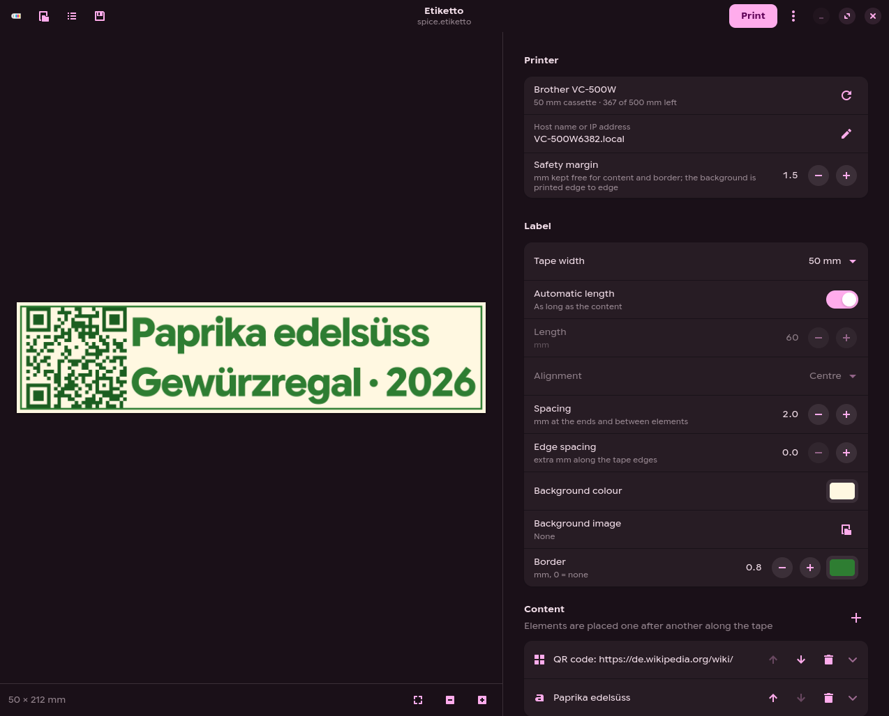
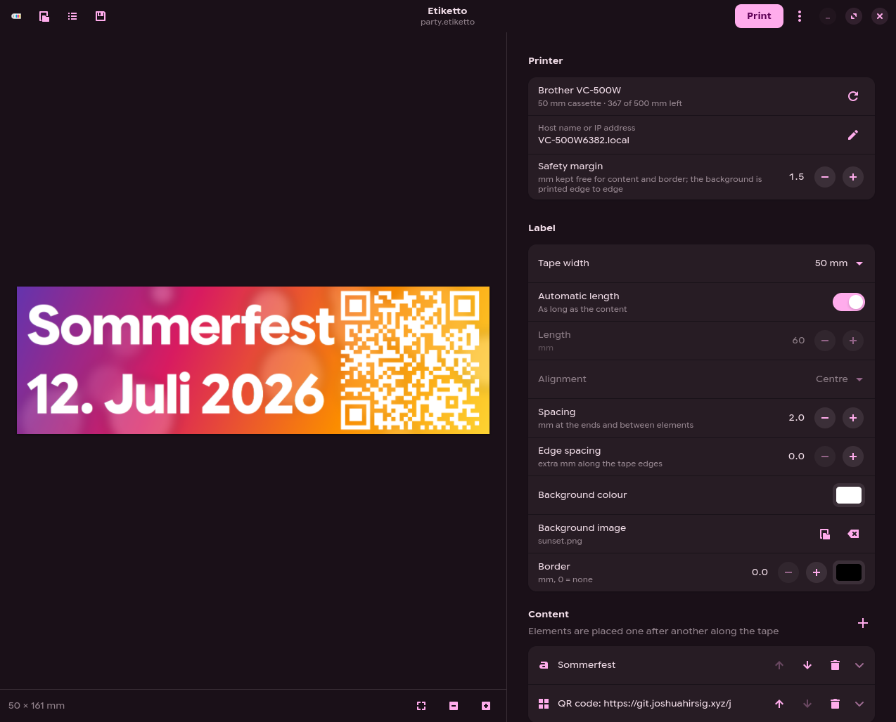
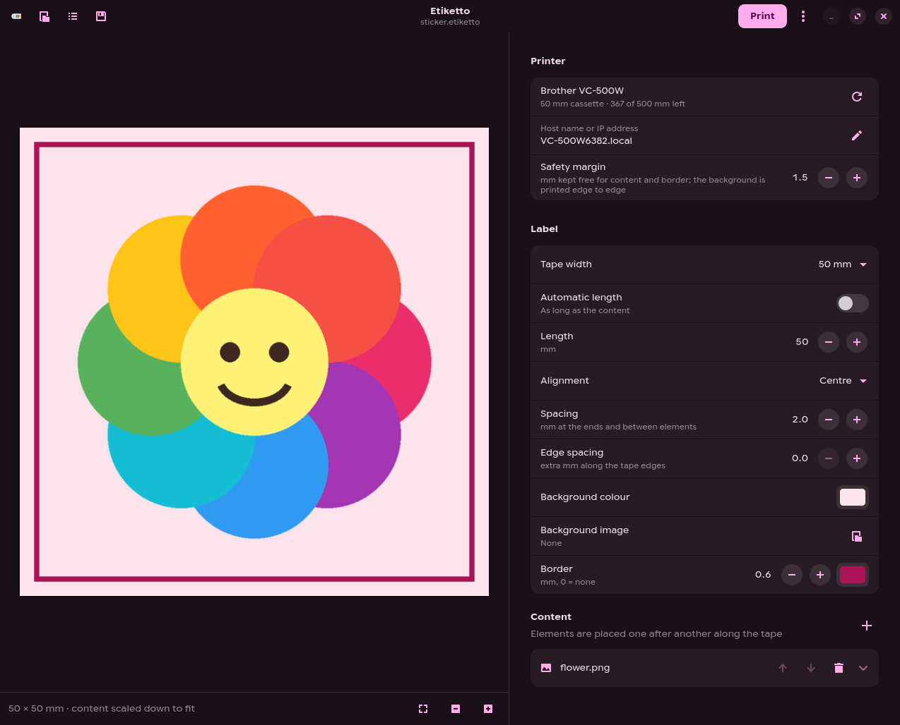
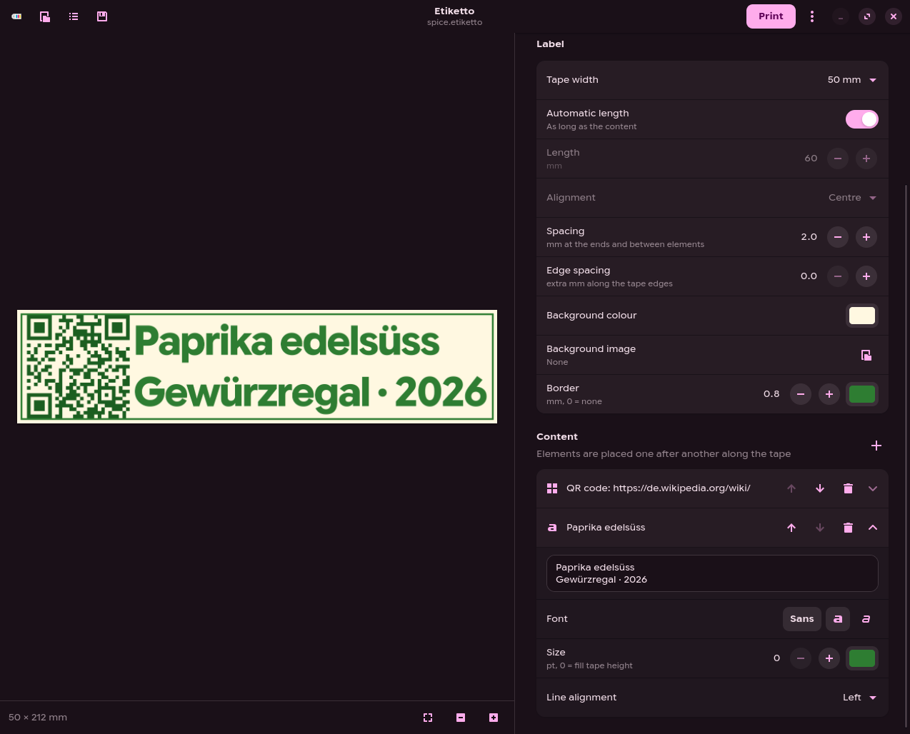
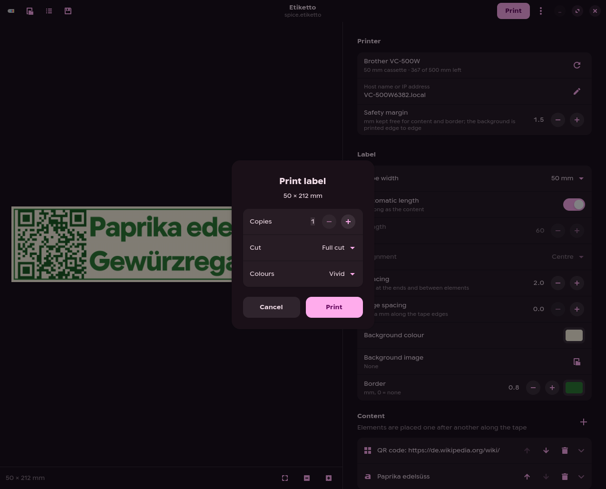
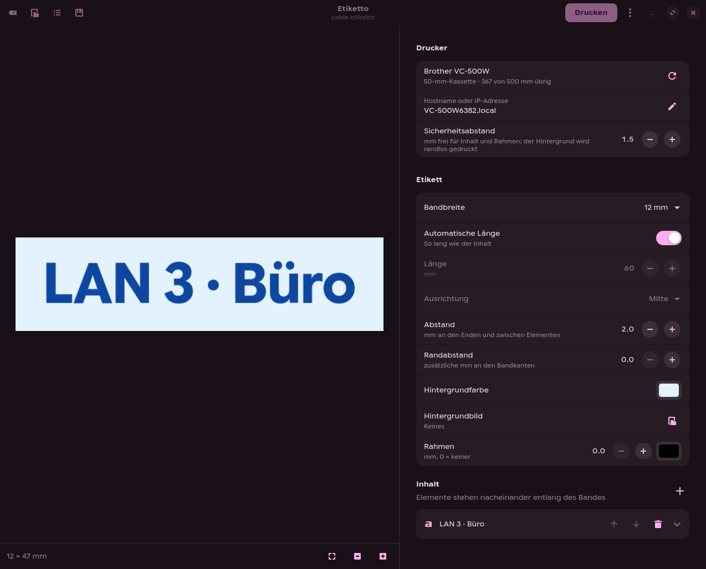

# Etiketto

Label designer for the **Brother VC-500W** colour label printer (ZINK
paper), for the Linux desktop. GTK 4 and libadwaita, English, German,
French and Italian.

Brother only ships the Color Label Editor for Windows, macOS and phones.
Etiketto brings the same workflow to Linux: the inserted cassette is
detected, the label grows with its content, and it prints over the network
in the printer's own protocol, including the **vivid** colour mode and the
**cut modes** that AirPrint does not offer.

## Screenshots



| | |
|---|---|
|  |  |
| Full colour: background image printed edge to edge | Sticker: fixed 50 × 50 mm, image and border |
|  |  |
| Text with any font, colour and size | Copies, cut mode, vivid or normal colours |
|  | |
| German interface (also French, Italian), 12 mm cable label | |

The labels shown are in [`docs/examples`](docs/examples); open them with Etiketto.

## Features

- Cassette detection (9, 12, 19, 25, 50 mm) and remaining tape
- Automatic length (as long as the content) or a fixed length in mm
- Text with any installed font, bold/italic, colour, multiple lines,
  size fitted to the tape or fixed in pt; emoji and font fallback via Pango
- Images and photos, background colour, background image, border
- QR codes, Code 128 and EAN-13 barcodes
- Live preview at print resolution: what you see is what is printed
- Print with vivid or normal colours, full cut, half cut or no cut, copies
- Save labels as `.etiketto` files (images embedded) and reuse them as templates
- Drag and drop images or `.etiketto` files onto the window
- Export as PNG

## Install

Requirements from your distribution: Python 3.11+, PyGObject with GTK 4
and libadwaita, pycairo, gettext. Everything else goes into a private
virtual environment.

```sh
git clone https://git.joshuahirsig.xyz/joshii/etiketto.git
cd etiketto
./install.sh                # per user, no root; ./install.sh --uninstall
```

| Distribution | system packages |
|---|---|
| Debian / Ubuntu | `python3-gi gir1.2-gtk-4.0 gir1.2-adw-1 python3-gi-cairo python3-venv gettext` |
| Fedora | `python3-gobject gtk4 libadwaita python3-cairo gettext` |
| Arch | `python-gobject gtk4 libadwaita python-cairo gettext` |
| Gentoo | `dev-python/pygobject gui-libs/gtk:4 gui-libs/libadwaita dev-python/pycairo` |

Then start **Etiketto** from the app menu. On first start enter the
printer's host name, e.g. `VC-500W1234.local` (needs mDNS / nss-mdns) or its
IP address. The host is also read from
`~/.config/labelprinter/config.json` if you use the `labelprinter` CLI.

## How labels are laid out

Elements (text, image, code) are placed one after another along the tape,
each filling the tape height unless a text has a fixed size. With
*Automatic length* the label is exactly as long as its content plus the
spacing; with a fixed length the content is aligned and, if needed, scaled
down. The printer adds a few millimetres of unprintable margin at the ends
for the cutter.

## Printers

Made for the Brother VC-500W, which is currently the only printer using
this protocol. Printing goes through
[labelprinter](https://github.com/sgrimee/labelprinter-vc500w) (native
protocol on TCP port 9100).

## Development

```sh
uv venv --system-site-packages .venv
uv pip install --python .venv/bin/python -e . pytest ruff
.venv/bin/python -m pytest
.venv/bin/ruff check . && .venv/bin/ruff format --check .
LANGUAGE=de .venv/bin/python -m etiketto.app
```

Translations: `xgettext` → `po/etiketto.pot`, strings in
`tools/strings_<lang>.py`, `python3 tools/fill_po.py de fr it` writes the
`.po` files; `install.sh` compiles them.

## Credits

The VC-500W protocol was reverse engineered by
[m7i.org](https://m7i.org/projects/labelprinter-linux-python-for-vc-500w/);
Etiketto prints through its descendant
[labelprinter](https://github.com/sgrimee/labelprinter-vc500w)
(m7i.org → lenchan139 → sgrimee).

## License

AGPL-3.0-or-later, like labelprinter which it builds on. Not affiliated with
Brother Industries; "Brother" and "VC-500W" are trademarks of their owners.
