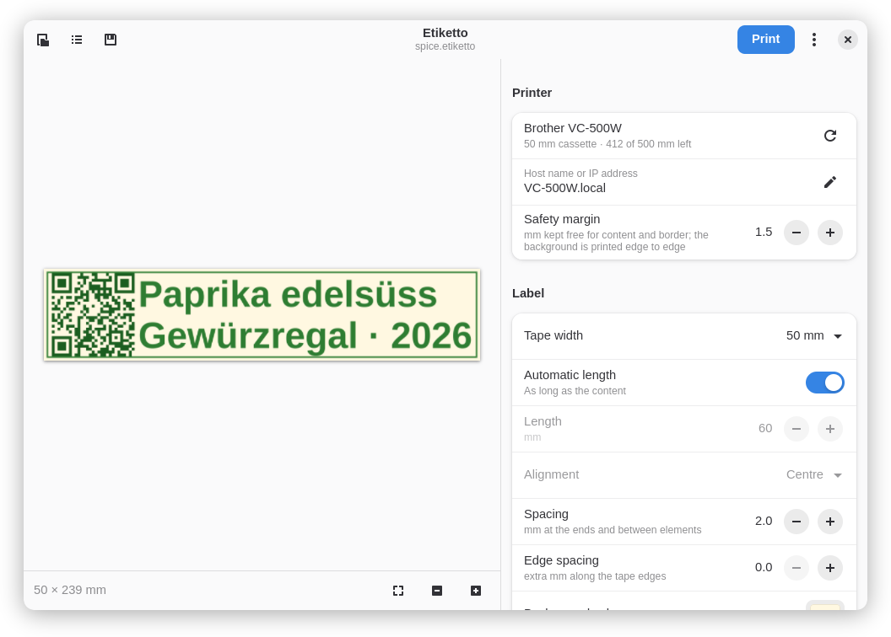
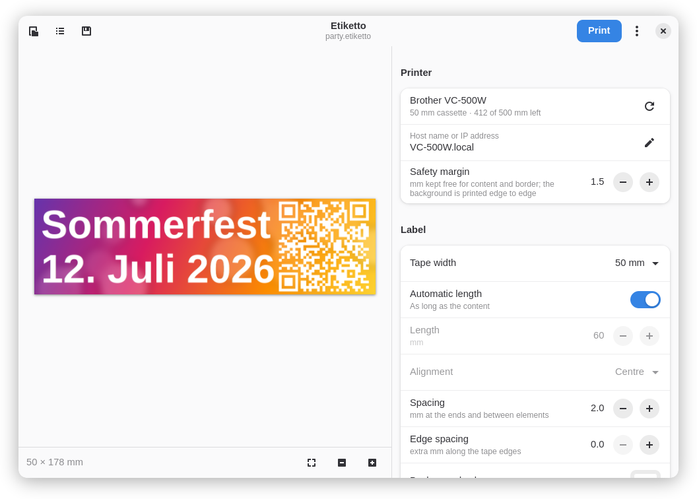
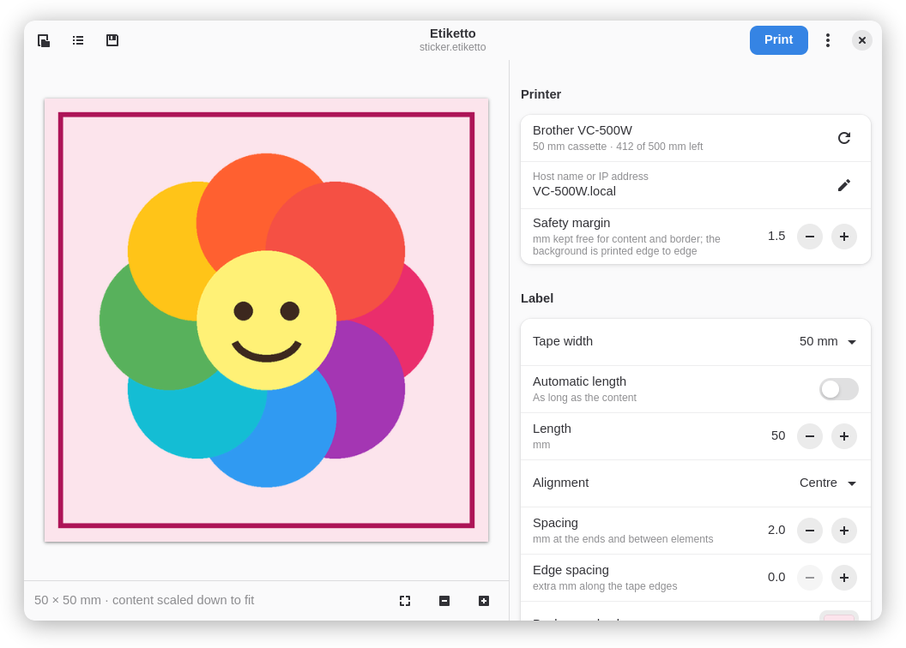
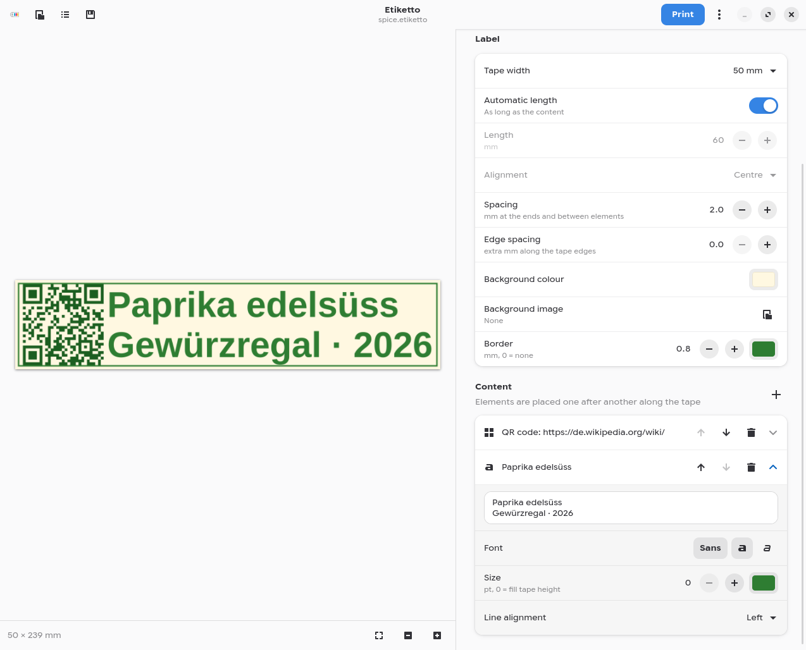
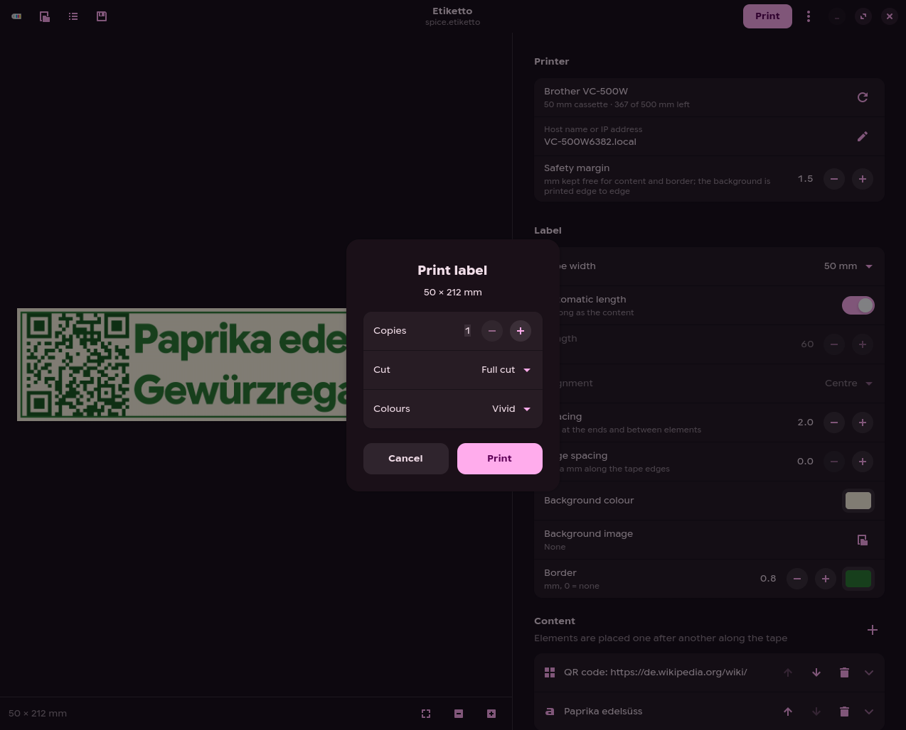
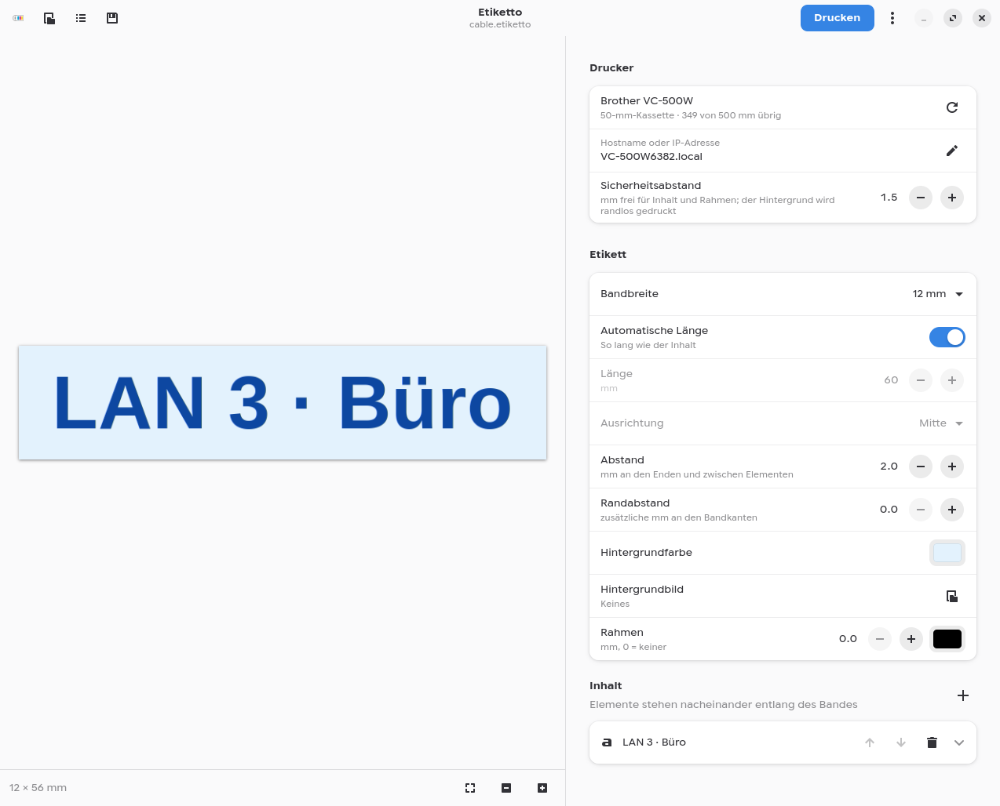
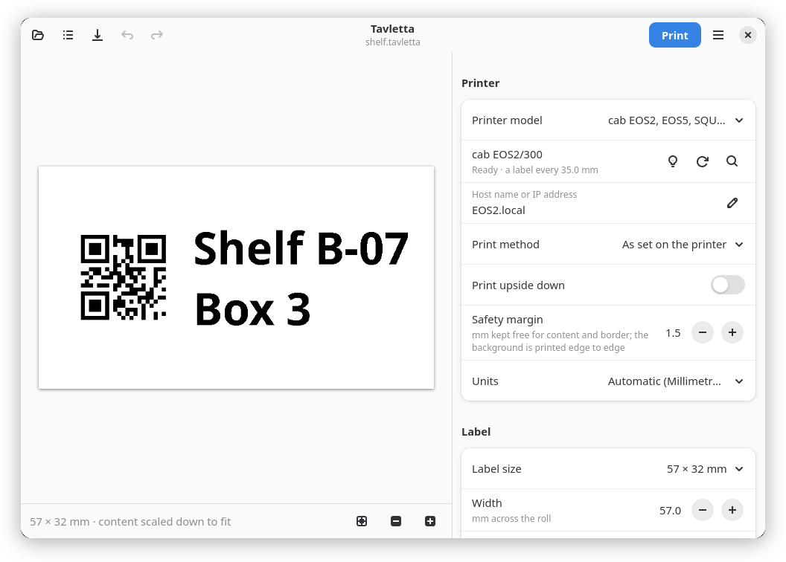
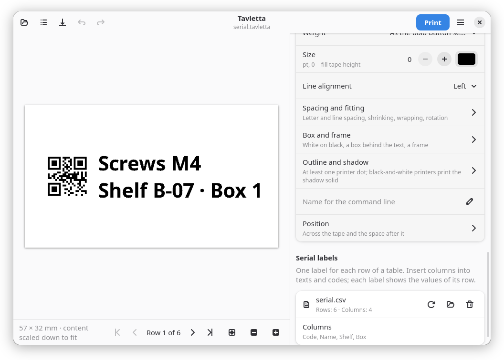
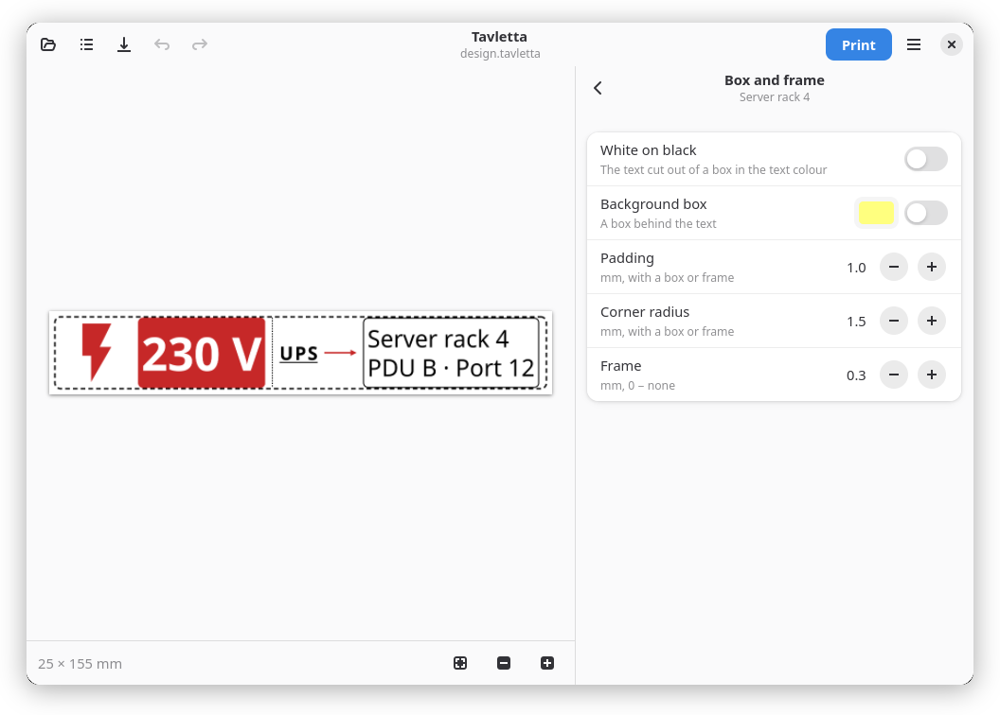

# Screenshots

<picture><source media="(prefers-color-scheme: dark)" srcset="screenshots/main-dark.png"></picture>

| | |
|---|---|
| <picture><source media="(prefers-color-scheme: dark)" srcset="screenshots/colour-dark.png"></picture> | <picture><source media="(prefers-color-scheme: dark)" srcset="screenshots/sticker-dark.png"></picture> |
| Full colour: background image printed edge to edge | Sticker: fixed 50 × 50 mm, image and border |
| <picture><source media="(prefers-color-scheme: dark)" srcset="screenshots/expand-dark.png"></picture> | <picture><source media="(prefers-color-scheme: dark)" srcset="screenshots/print-dark.png"></picture> |
| Text with any font, colour and size | Copies, cut mode, vivid or normal colours |
| <picture><source media="(prefers-color-scheme: dark)" srcset="screenshots/cable-de-dark.png"></picture> | <picture><source media="(prefers-color-scheme: dark)" srcset="screenshots/die-cut-dark.png"></picture> |
| German interface (27 languages in total), 12 mm cable label | Die-cut label on a cab EOS2: QR code and text on 57 × 32 mm |
| <picture><source media="(prefers-color-scheme: dark)" srcset="screenshots/serial-dark.png"></picture> | <picture><source media="(prefers-color-scheme: dark)" srcset="screenshots/design-dark.png"></picture> |
| Serial labels: `{Name}` and `{Code}` filled from each row of a CSV file | Text in a box or frame, a dotted separator, an arrow, a dashed border with round corners |

Screenshots use the default GNOME style; Tavletta follows your desktop's light or dark mode and accent colour.

The labels shown are in [`docs/examples`](examples); open them with Tavletta.
